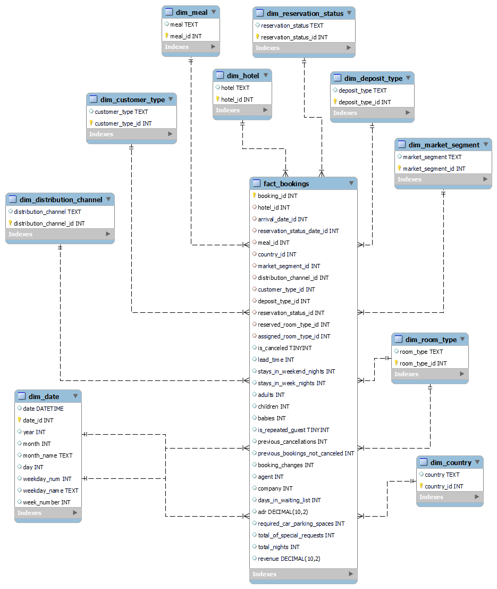
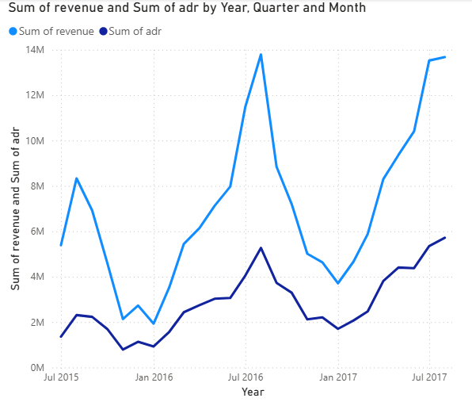
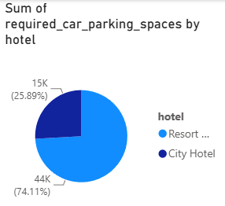
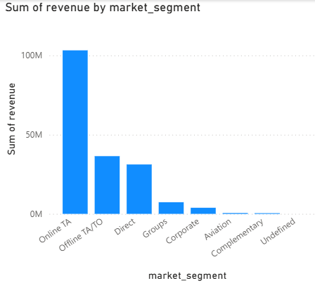
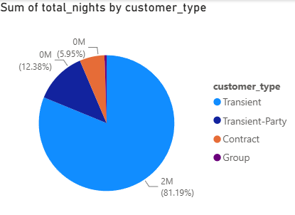
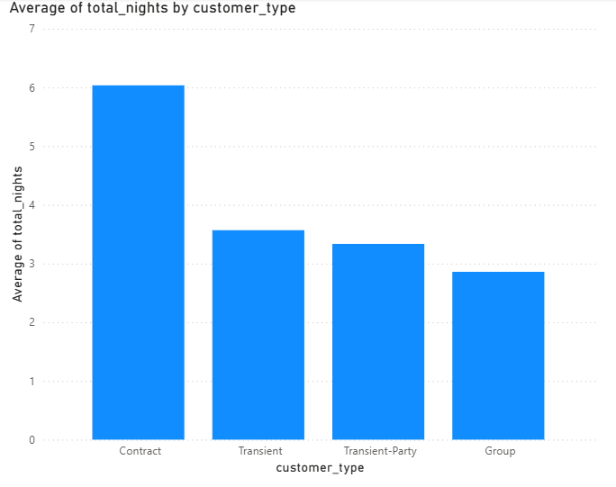
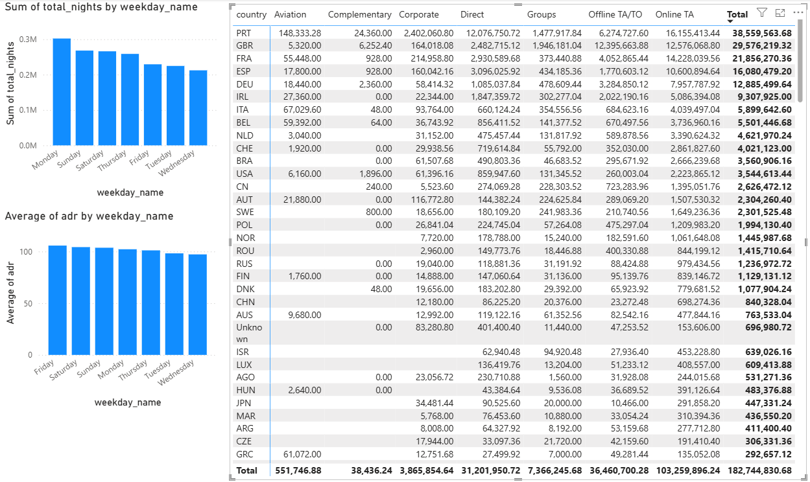

# Hotel Bookings Data Warehouse & Business Intelligence

A data warehousing and business intelligence project built with **Python, Pandas, MySQL, and Microsoft Power BI**, exploring more than 119,000 hotel booking records.

The project covers data preparation, transformation, dimensional modelling, database integration, and interactive business intelligence reporting.

## Project Overview

The goal of this project was to transform raw hotel booking data into a structured data warehouse and use it to explore booking patterns, revenue, cancellations, and customer behaviour.

The workflow involved:

- Cleaning and transforming the original dataset using Python and Pandas.
- Creating fact and dimension tables based on a star schema.
- Integrating Python with MySQL for database loading.
- Developing a seven-page Power BI report to explore the data through visualisations and aggregated analyses.

## Technologies

| Technology | Purpose |
|---|---|
| Python | Data preparation and ETL |
| Pandas | Data cleaning and transformation |
| MySQL | Relational database and data warehouse |
| MySQL Connector/Python | Python–MySQL integration |
| Microsoft Power BI | Business intelligence and visualisation |

## Project Workflow

1. **Data preparation** – Loaded and cleaned the original hotel bookings dataset using Pandas.
2. **Data transformation** – Derived analytical attributes, including total nights, arrival dates, weekdays, and booking revenue.
3. **Dimensional modelling** – Designed a star-schema-based warehouse with a central fact table and supporting dimension tables.
4. **ETL and database integration** – Prepared fact and dimension data and integrated Python with MySQL for data loading.
5. **Business intelligence** – Developed a Power BI report containing seven pages of analytical visualisations.

## Data Warehouse Design

The warehouse follows a star-schema structure, consisting of a central `fact_bookings` table connected to ten dimension tables:

- `dim_country`
- `dim_customer_type`
- `dim_date`
- `dim_deposit_type`
- `dim_distribution_channel`
- `dim_hotel`
- `dim_market_segment`
- `dim_meal`
- `dim_reservation_status`
- `dim_room_type`

The fact table contains booking-related measures and keys linking bookings to their corresponding dimensions.

**Star schema:**



## Power BI Report

The Power BI report consists of seven pages exploring different aspects of hotel booking data.

### Report Preview

**1. Revenue and Average Daily Rate (ADR) Over Time**



**2. Required Parking Spaces by Hotel**



**3. Revenue by Market Segment**



**4. Total Nights by Customer Type**



**5. Cancellations Over Time**


**6. Average Total Nights by Customer Type**



**7. Weekday Analysis**



An aggregated CSV export of the weekday analysis is also available in the `powerbi/` directory.

The original Power BI report file (`.pbix`) is not included in this repository.

## Repository Structure

```text
hotel-bookings-data-warehouse/
├── docs/
│   └── star_schema.png
├── notebooks/
│   ├── dataPrep.ipynb
│   └── ETL.ipynb
├── powerbi/
│   ├── 01-revenue-and-adr.png
│   ├── 02-parking-spaces-by-hotel.png
│   ├── 03-revenue-by-market-segment.png
│   ├── 04-nights-by-customer-type.png
│   ├── 05-cancellations-over-time.png
│   ├── 06-average-nights-by-customer-type.png
│   ├── 07-weekday-analysis.png
│   └── weekday-analysis-data.csv
├── .gitignore
├── README.md
└── requirements.txt
```

The `data/` directory is excluded from version control, so the original dataset and generated CSV files are not included.

## Getting Started

### Prerequisites

- Python 3.11 or a compatible version
- MySQL Server
- Jupyter Notebook
- Microsoft Power BI Desktop (for viewing or recreating the report)

### Install dependencies

Clone the repository and install the required Python packages:

```bash
git clone https://github.com/zehragrbovic/hotel-bookings-data-warehouse.git
cd hotel-bookings-data-warehouse
pip install -r requirements.txt
```

### Database configuration

The notebooks use environment variables for MySQL connection settings:

```text
DB_HOST=localhost
DB_USER=your_mysql_username
DB_PASSWORD=your_mysql_password
DB_NAME=hotel_bookings
```

Configure these variables in your local environment before running the database-loading cells.

### Data availability

The original dataset and generated CSV files are not currently distributed with this repository because their original source and redistribution licence have not yet been verified.

## Notes

This repository documents an academic Business Intelligence project. The notebooks preserve the development workflow, including exploratory and experimental work.

The MySQL database and original Power BI report file are maintained separately from the public repository.

## Author

**Zehra Grbović**